# qson-ui-skills

Qson 的个人 UI 设计效果 skill 家族：把短视频与实战里验证过的高级交互效果，整理成可被 AI 助手直接调用的独立 skill。

## 结构

家族采用扁平独立加前缀命名：每个分类是一个真正的独立 skill（各自有触发描述、可单独检索、单独安装），总索引负责名册与收纳流程。发布到 GitHub 时，把下列文件夹原样放进本仓库根目录即可。

| Skill | 分类 | 状态 |
| --- | --- | --- |
| `qson_ui` | 总索引与收纳流程 | active |
| `qson_ui_popup` | 高级弹窗交互 ×6 | verified-demo |
| `qson_ui_layout` | 高级审美布局 原则×5 配方×6 | draft |
| `qson_ui_cards` | 卡片与按钮交互 ×8 | draft |
| `qson_ui_feedback` | 高级提示动效 ×8 | draft |
| `qson_ui_components` | 交互组件 ×12 | draft |
| `qson_ui_transitions` | 转场与手势 ×14 | draft |
| `qson_ui_dashboard` | Dashboard 风格×17 导航×12 布局交互×25 | draft |
| `qson_ui_micro` | 动态图标 两类 | draft |
| `qson_ui_web` | Web 高级交互 ×10 | draft |
| `qson_ui_principles` | Apple 式审美原则 静态规范+交互准则 | draft |
| `qson_ui_workflow` | AI 做 UI 工作流 方法+清单 | draft |
| `qson_ui_loading` | 加载状态 扫光骨架屏/平滑进度条/模糊到清晰 | draft |

状态定义：draft 只有描述 / verified-demo 有可预览 demo 并目检通过 / production 已在真实项目用过。

## 效果图鉴

每条收录都在这里有一张示意图和一段介绍：图是机制示意（线框图），不是原视频截图；数值以各 skill 的 references 为准，视频未明示的一律标推荐值。

### 高级弹窗 ×6 · `qson_ui_popup`

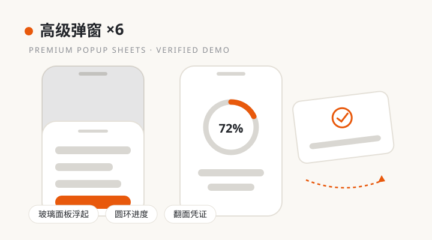

普通弹窗是「啪地出现一张卡」，这一组把弹窗做成有物理感的仪式：背景先模糊退后，面板随后浮起，面板内部元素再错峰入场。六种模式覆盖大多数业务场景：玻璃面板浮起（通用确认与详情）、圆环进度（等待与进度型任务）、刻度尺扫到今天（日期与数值选择）、照片抽屉贴合（相册式内容）、点击翻面凭证（票券与凭证正反面）、下拉展开面板（从触发点长出来）。家族里唯一有可运行 demo 并目检通过的条目。
代表效果：玻璃面板 / 圆环进度 / 刻度尺 / 照片抽屉 / 翻面凭证 / 下拉展开 · 状态 verified-demo · 来源：西瓜同学《高级交互》第 13 集

### 高级审美布局 · `qson_ui_layout`

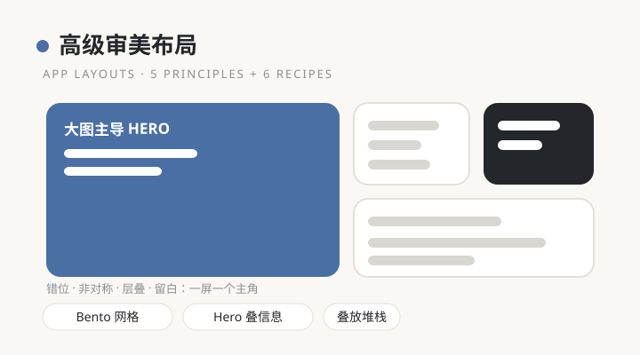

解决「排得满满当当却没有重点」的通病：五条原则先定气质，错位制造节奏、大图主导确立主角、非对称打破呆板、层叠建立前后关系、留白负责高级感；六个配方直接套用，宽体大图列表、Hero 叠信息、黑白两档、Bento 网格、海报转盘、叠放堆栈。判断标准只有一条：一屏只有一个主角，其余元素都是配角。
代表效果：错位 Stagger / 大图主导 / Bento / 海报转盘 · 状态 draft · 来源：西瓜同学《高级交互》第 3、12 集

### 卡片与按钮交互 ×8 · `qson_ui_cards`

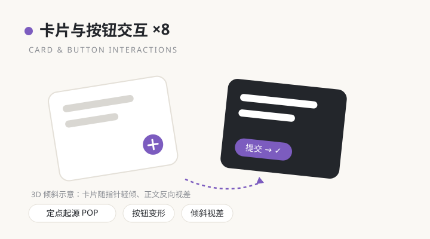

让每一次点按都有来处和去处：内容从被点的位置长出来（定点起源 POP），按钮提交后在原地变形报结果（发送变对勾、加号变关闭），卡片能甩动翻页、随指针倾斜透出视差，长按浮起预览，筛选与视图切换时元素飞到新位置而不是整页重排。核心是空间连续性：用户的眼睛始终跟得上变化发生在哪里。
代表效果：定点起源 / 按钮变形 COMMIT / 甩动翻页 / 列表转网格 / 倾斜视差 / 长按浮起 · 状态 draft · 来源：西瓜同学《高级交互》第 4 集

### 高级提示动效 ×8 · `qson_ui_feedback`

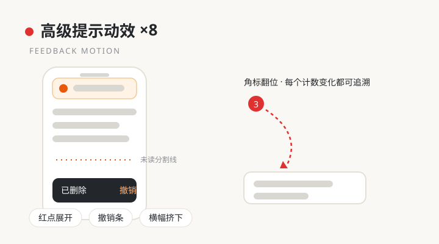

提示的职责是通知，不是抢戏。红点被点开时展开成来源面板，告诉你这条提醒从哪来；撤销条把倒计时画在明处，处理过的条目沿原路收回；新横幅把旧内容轻轻挤下去而不是盖住；未读分割线要等用户真正滚过才淡出。贯穿原则是：每一个计数变化都要能追溯到原因，不许数字无声无息地自己变。
代表效果：红点展开 / 提示队列 / 撤销条 / 角标翻位 / 横幅挤下 / 未读分割线 · 状态 draft · 来源：西瓜同学《高级交互》第 6 集

### 交互组件 ×12 · `qson_ui_components`

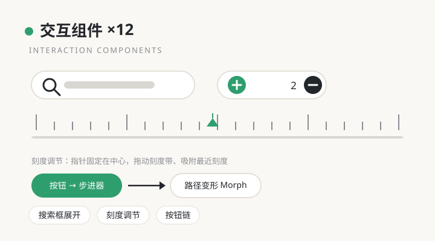

把高频小组件做成会变形的活物：搜索图标点开长成输入框，加号展开成动作面板，按钮点完能接着变步进器继续调数量，顶栏随滚动收起把空间让给内容，刻度调节固定中心指针、拖动刻度带并吸附最近刻度，图表与数据面板之间双向联动。单件看是组件，连起来是整页的呼吸感。
代表效果：搜索框展开 / Button Chain / 弹性 tab 指示 / 按钮变步进器 / 刻度调节 / 数据面板联动 · 状态 draft · 来源：西瓜同学《高级交互》第 10、16 集

### 转场与手势 ×14 · `qson_ui_transitions`

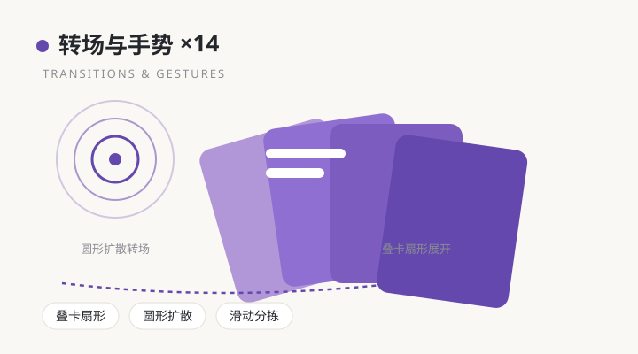

页面与页面、状态与状态之间不再硬切：完成动作时粒子迸发给一个明确的句号（Done Burst），一个勾选能同时带动圆环、计数与底色（勾选联动），卡片像扇子一样展开收拢，主题切换以圆形扩散从触发点漫过全屏，滑动分拣时下一张卡以 0.92 缩放提前待命。手势的方向就是内容的去向，眼睛不需要重新找。
代表效果：完成反馈 / 勾选联动 / 叠卡扇形 / 圆形扩散 / 滑动分拣 / 波形进度 · 状态 draft · 来源：西瓜同学《高级交互》第 14、15 集

### Dashboard 设计系统 · `qson_ui_dashboard`

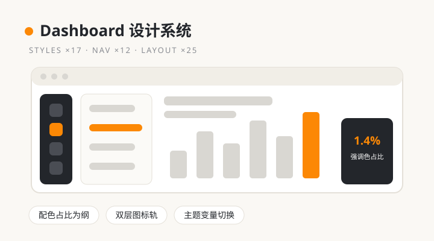

后台系统高级感的来源不是多上色，而是先定配色占比再定颜色：暗色控制台里橙色只占约 1.4%、只给操作处，玻璃拟态用实心重色压住约 1%，荧光方案八成近白加一支荧光点睛。导航 12 种以侧边栏为主线（悬浮导视、双层图标轨、悬停折叠展开、分组留白），布局交互 25 项讲结构（Hero 主模块、横带分层、为交互留位、图表原位放大、只换四个变量的主题切换）。明确避坑：紫渐变加满屏等大卡。
代表效果：配色占比 / 双层图标轨 / Hero Module / 主题变量切换 · 状态 draft · 来源：西瓜同学《Dashboard 高级设计与交互》第 1–9 集

### 动态图标 两类 · `qson_ui_micro`

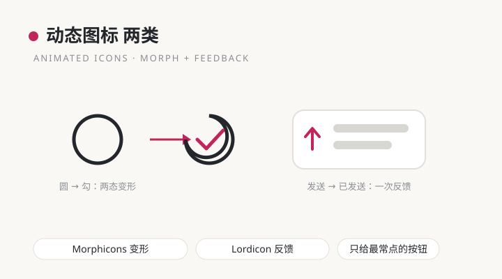

图标动效只分两类、只用在刀刃上：两态来回切换用变形图标（Morphicons），圆变勾、加变叉、播放变暂停、日变月，形变本身把状态变化讲清楚；一次性操作反馈用播放型图标（Lordicon），动作播完即止，线条色随页面主色。纪律很硬：会动的图标只给最常点的按钮，全页铺动态图标等于没有重点。
代表效果：Morphicons 两态变形 / Lordicon 一次反馈 · 状态 draft · 来源：西瓜同学《Skill 实战》第 17 集

### Web 高级交互 ×10 · `qson_ui_web`

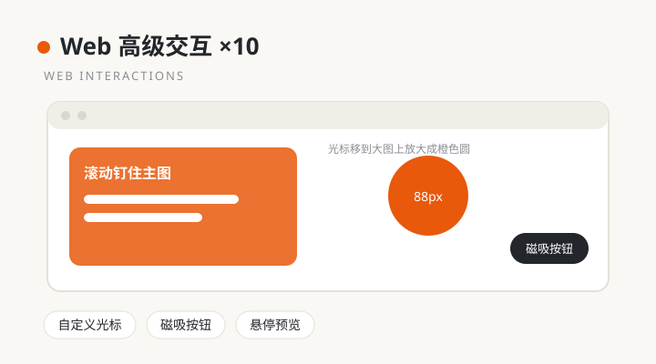

网页端的存在感来自对指针的回应：主图随滚动钉住、内容在两侧流动，光标移到大图上放大成 88px 的橙色圆，按钮对指针有磁吸，功能块悬停时以箭头为圆心扩散翻色，拖动条分档吸附，图表跟着鼠标走，换肤以圆形扩散完成。总原则一句话：每个能点的元素，都要有停留反馈。
代表效果：滚动钉图 / 自定义光标 / 磁吸按钮 / 悬停翻色 / 圆形扩散换肤 · 状态 draft · 来源：西瓜同学《Skill 实战》第 19 集

### Apple 式审美原则 · `qson_ui_principles`

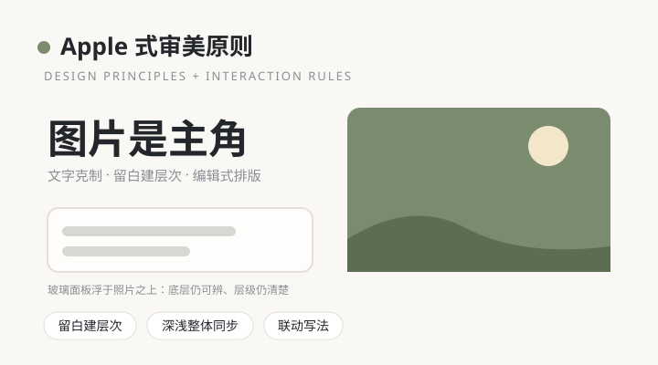

不是效果集合，而是一套判断标准，分静态规范与交互落地两半：留白建层次、图片做主角文字克制、编辑式排版用超大标题加不对称网格、深浅模式整体同步而不是只换底色、玻璃面板浮在照片上仍要能辨底层与层级；落地侧要求把「触发条件＋响应对象＋变化方式」写进同一句联动句，内容滚动分批揭示、切片错峰、预载不闪空，减少动态时直接更新。本仓库的设计成熟度评审标准（10 条 100 分制）也收在这里。
代表效果：留白建层次 / 编辑式排版 / 联动写法 / 错峰分批揭示 · 状态 draft · 来源：西瓜同学《Skill 实战》第 20、21 集

### AI 做 UI 工作流 · `qson_ui_workflow`

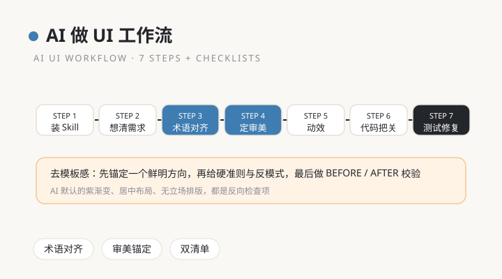

管的不是某个效果，而是让 AI 稳定做出好 UI 的全过程：装 Skill、想清需求、术语对齐、定审美、加动效、代码把关、自动测试修复，七步推进。关键判断是「模型决定下限，Skill 决定上限」，配套去模板感 9 条（先锚定一个鲜明方向、给硬准则与反模式而不是建议、用审美校验做 BEFORE/AFTER 对照）和编码前、交付前两张清单。模糊需求先翻译成效果名加实现方式，再动手。
代表效果：七步工作流 / 术语对齐 / 去模板感 9 条 / 双清单 · 状态 draft · 来源：西瓜同学《Skill 实战》第 1、2、16、18 集精看

### 加载状态三式 · `qson_ui_loading`（2026-11-06 新收）

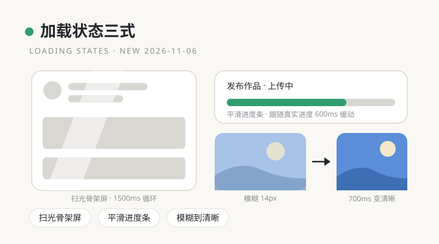

专治 AI 做页面的默认加载：中间一个圈转半天，内容到齐后整页突然蹦出来。这一条给出三个能直接报给 AI 的名字。扫光骨架屏：内容没到时先按真实布局摆出同形灰块，一层半透明光带 1500ms 一遍从左往右匀速横扫，只动位移不触发重排。平滑进度条：上传、发布这类有真进度的事，进度跟随真实百分比，数值之间用 600ms 缓动补间，不跳格也不假装匀速。模糊到清晰：图片入场从 14px 模糊开始，700ms 内锐化落定，比单纯淡入柔和。三式各管一段等待、可同页组合，哪段先好先落定哪段。数值均为视频明示值。
代表效果：扫光骨架屏 / 平滑进度条 / 模糊到清晰 · 状态 draft · 来源：BeiYu 北煜《动廊图鉴》第 1 集（2026-11-05）

## 如何使用

本库有两种安装方式：人工安装（自己动手放文件夹）和 Agent 安装（把一句话发给你的 AI 助手，它自己装好）。任选其一，装完的使用方法相同。

### 方式一：人工安装

1. 克隆或下载本仓库到本地任意目录：

```bash
git clone https://github.com/Qson8/qson-ui-skills.git
```

2. 把 `qson_ui*` 文件夹复制到你所用工具的 skills 目录。全部复制是完整家族，只复制其中几个就是只装那几个分类，可以混搭。常见工具的目录：

| 工具 | skills 目录 |
| --- | --- |
| Claude Code | `~/.claude/skills/`（全局）或项目内 `.claude/skills/` |
| Muse | `~/workspace/custom-skills/` |
| Codex 等支持 Agent Skills 的工具 | 该工具文档指定的 skills 目录（如 `~/.codex/skills/`，以工具当前文档为准） |

```bash
# 示例：把全部家族装进 Claude Code
cp -r qson-ui-skills/qson_ui* ~/.claude/skills/
# 示例：只装弹窗一个分类
cp -r qson-ui-skills/qson_ui_popup ~/.claude/skills/
```

3. 验证安装：重启或刷新工具后问一句“qson_ui 里有什么效果”，能列出分类即装好；或直接提一个带关键词的需求，如“做一个高级弹窗”，观察是否命中对应 skill。
4. 更新：仓库有新版本时，在克隆目录 `git pull`，再重复第 2 步覆盖复制即可。

### 方式二：Agent 安装（推荐）

把下面这段话原样发给你的 AI 编程助手（Claude、Codex、WorkBuddy 等均可），它会自己完成安装并验证：

```text
请安装 qson-ui-skills 这套 UI 设计效果 skill 家族：
1. 克隆 https://github.com/Qson8/qson-ui-skills 到本地一个稳定目录；
2. 把仓库里的 qson_ui 开头的全部文件夹，整体复制到你当前环境的 skills 目录中（用你所在工具的规范目录，不要改文件夹名和内部结构）；
3. 逐个检查每个文件夹都有 skill.yaml 和 SKILL.md；
4. 用“高级弹窗”“Dashboard 侧边栏”“圆形扩散 扇形”各检索一次，确认能命中对应 skill；
5. 最后告诉我装好了哪几个 skill、分别管什么。
```

### 装完怎么用

装好后不需要记命令，用自然语言提需求就会按关键词触发，也可以点名调用：

| 你想做的事 | 这样说 | 命中的 skill |
| --- | --- | --- |
| 做弹窗 | “做个高级弹窗，玻璃面板浮起的那种” | `qson_ui_popup` |
| 排首页 | “用高级布局排这个首页，要有主次” | `qson_ui_layout` |
| 改后台 | “这个 Dashboard 侧边栏怎么改才高级” | `qson_ui_dashboard` |
| 加图标动效 | “模式切换的图标要会变形” | `qson_ui_micro` |
| 查全部库存 | “qson_ui 里都收了什么” | `qson_ui` 总索引 |
| 怕 AI 做得模板化 | “按 AI 做 UI 的工作流来，先对齐术语再动手” | `qson_ui_workflow` |

### 没有 Skill 机制的工具

打开目标分类文件夹，把 `SKILL.md` 的效果说明与 `references/prompts.md` 里的描述词贴给 AI 当需求描述即可，效果、顺序与数值都在里面，不依赖 Skill 机制。

### 继续收纳新效果

把视频链接或效果描述发给你的 AI 助手并说“收进 qson-ui”：新效果进对应分类的 references 并在总索引注册表登记；新分类按 `qson_ui_` 加短名新建独立 skill，命名与结构规范见总索引 `qson_ui` 的 SKILL.md。

## 状态与站点

- 公开仓库，持续收纳中；当前为总索引 + 12 个分类 skill、百余条目。
- 个人站点产品页：https://blog.hanfucn.com/products/qson-ui-skills （上线后生效，内容与本 README 同步）

## 本地位置

工作副本在 `~/workspace/custom-skills/qson_ui*`（日常收纳改那边）；本目录是发布仓库，内容为工作副本的同步快照，发布前先从工作副本同步一次再提交，避免两份漂移。

## 收纳纪律

- 新效果进已有分类：写进该分类 skill 的 references，并在总索引注册表登记。
- 新分类：按 `qson_ui_` 加短 slug 新建独立 skill，描述必须含中英文真实触发词并实测检索命中。
- 每次收录必须同步在本 README 的「效果图鉴」里加一条图文介绍（示意图一张 + 介绍一段 + 代表效果与来源一行），图存 `assets/readme/`，用 SVG 线框示意图，不拿来源视频截图冒充。
- 来源必须记录作者、链接与日期；原视频未明示的时长与尺寸一律标“推荐值”，不冒充原值。
- 效果用自己的话复述机制，不抄原文长句。
